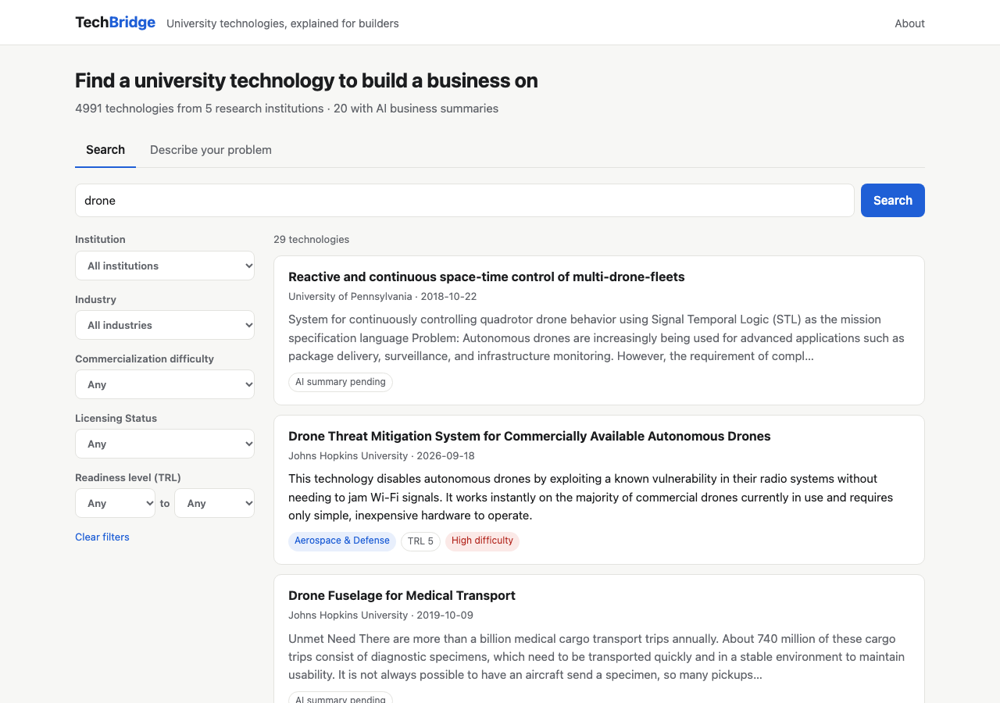
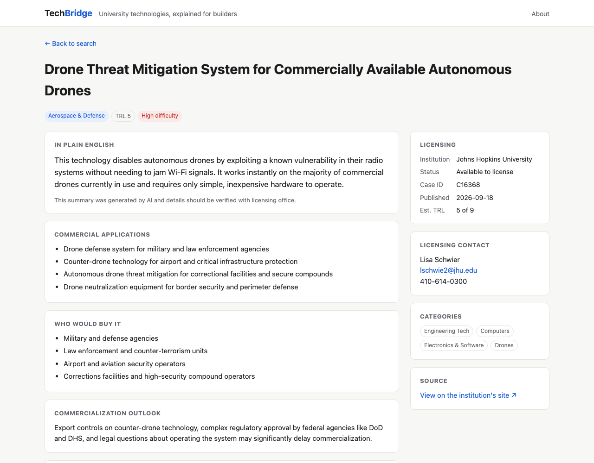

# TechBridge

[](https://github.com/rab2005/techbridge/actions/workflows/tests.yml)

**AI-powered technology transfer discovery.** TechBridge collects technologies that universities have made available for licensing, uses AI to explain each one in plain English for entrepreneurs, and lets you search by keyword or by describing a business problem.

**Live site: https://techbridge-ot02.onrender.com** (free hosting, so the first visit after a quiet period takes about a minute to wake up)



## Why I built this

Universities invent countless technologies, and most never get used. Usually that's not because the ideas are bad. It's because nobody outside the lab knows they exist, and the listings are written in dense scientific and legal language that hides the business opportunity. I've always been interested in entrepreneurship, so I built TechBridge to put these inventions in one place and explain them in terms a founder can act on: what it is, what you could sell, who would buy it, and how hard it would be to bring to market.

## Features

- **~5,000 technologies from 5 universities**, collected automatically from their technology transfer offices and kept up to date daily
- **Plain-English AI summaries**: summary, commercial applications, target customers, industry, technology readiness level (TRL), and commercialization difficulty
- **Keyword search** with filters for institution, industry, difficulty, TRL, and licensing status
- **"Describe your problem"**: type a business problem and get technologies that match by meaning, not just keywords
- **Listing status tracking**: technologies a university removes from its site are marked "no longer listed" instead of silently disappearing



## How it works

```
 TTO websites ──► scraper.py ──► SQLite (data/techbridge.db) ──► api.py (FastAPI) ──► static/ (web UI)
 (RSS + pages)                     ▲              ▲
                       enrich.py ──┘              └── embeddings.py
             (Claude: summary, applications,       (local embedding model for
              customers, industry, TRL, difficulty) "Describe your problem")
```

| Phase | Module | What it does |
|---|---|---|
| 1. Ingestion | `techbridge/scraper.py` | Reads each university's RSS feed, then visits each technology page for the full abstract, categories, and licensing contact |
| 2. AI enrichment | `techbridge/enrich.py` | Sends each listing to Claude (Haiku 4.5) with structured output: summary, 3–5 applications, target customers, industry, TRL (1–9), commercialization difficulty |
| 3. Search API + UI | `techbridge/api.py`, `static/` | Keyword search (SQLite FTS5) with filters for institution, industry, difficulty, TRL, and licensing status; technology detail pages |
| 4. Reverse search | `techbridge/embeddings.py` | Embeds every technology with a small open-source model ([bge-small-en-v1.5](https://huggingface.co/BAAI/bge-small-en-v1.5)) that runs locally; a user's problem description is embedded and matched by cosine similarity |

### Data sources

Many universities publish their available technologies on Inteum's *Technology Publisher* platform, which offers a public RSS feed per institution. TechBridge currently covers:

- Johns Hopkins University
- University of Pennsylvania
- University of Chicago
- University of Rochester
- University of Arizona

Each school customises its page template, so `parse_detail()` tries a few selectors per field. To add another school on this platform, add its subdomain to `INSTITUTIONS` in `techbridge/config.py` and check its page parses (see `tests/fixtures/`).

The scraper identifies itself with a descriptive User-Agent, waits 1 second between requests, and by default only fetches technologies it hasn't seen before.

## Setup

Requires Python 3.11+.

```bash
python3 -m venv .venv
source .venv/bin/activate
pip install -r requirements.txt
cp .env.example .env        # then put your Anthropic API key in .env
```

## Usage

```bash
python -m techbridge scrape --limit 25   # up to 25 new technologies per university (0 = all)
python -m techbridge enrich              # Claude summaries for anything not yet enriched
python -m techbridge embed               # embeddings for reverse search (local, free)
python -m techbridge stats               # counts per institution
python -m techbridge update              # scrape + enrich + embed, new listings only
python -m techbridge serve               # open http://localhost:8000
```

Scrape and enrich are incremental, so re-running them only processes new records. Use `--refresh` (scrape) or `--force` (enrich/embed) to redo existing ones.

Enriching a technology clears its old search vector, so the next `embed` (or `update`) re-embeds it with the AI summary included. The first `embed` run downloads the model (~100MB) once.

Only one scrape runs at a time; a second one exits with "another scrape is already running".

The app works without an Anthropic key: technologies show their original abstract, and "Describe your problem" still works because embeddings run locally.

### API key and cost

Create an API key at [console.anthropic.com](https://console.anthropic.com). API usage is billed separately from a Claude.ai Pro/Max subscription, so you'll need to add API credits.

With Claude Haiku 4.5 ($1 / $5 per million input/output tokens), each technology costs well under a cent, so 500 technologies cost a couple of dollars. To use a different model, set `CLAUDE_MODEL` in `.env` (e.g. `claude-sonnet-5-5`). Embeddings are free because they run on your machine.

## Automatic daily updates

`scripts/schedule.sh` installs a macOS launchd job that runs `python -m techbridge update` every day: it scrapes new listings, writes AI summaries if `ANTHROPIC_API_KEY` is set (otherwise skips that step), and refreshes search. If the Mac is asleep at the scheduled time, it runs when it wakes. The web app picks up new data without a restart.

```bash
scripts/schedule.sh install      # daily at 6:00am (or: install 22 for 10pm)
scripts/schedule.sh status       # installed? + last lines of data/update.log
scripts/schedule.sh run          # run it now
scripts/schedule.sh uninstall
```

## Deployment

The website runs on [Render](https://render.com)'s free plan, configured in `render.yaml`. Scraping and AI summaries run on my Mac, and the website serves a snapshot of the database:

```bash
scripts/publish.sh    # copy the current database to deploy/, commit, and push
```

Render redeploys automatically on every push to `main`, so code changes go live too. GitHub Actions runs the test suite on every push (badge above).

## API

| Method | Path | Description |
|---|---|---|
| GET | `/api/technologies?q=&institution=&industry=&difficulty=&status=&trl_min=&trl_max=&page=` | Search and filter |
| GET | `/api/technologies/{id}` | Full record |
| GET | `/api/facets` | Filter options and counts |
| POST | `/api/match` `{"problem": "...", "limit": 10}` | Reverse search |

Interactive docs: http://localhost:8000/docs

## Tests

```bash
python -m pytest
```

Tests use saved HTML pages from each university (`tests/fixtures/`) plus fake stand-ins for Claude and the embedding model, so they run offline and free.

## Project structure

```
techbridge/
  config.py       settings, institution list
  db.py           SQLite schema + full-text index
  scraper.py      data ingestion
  enrich.py       AI summaries (prompt lives here)
  embeddings.py   semantic search
  api.py          FastAPI routes
  __main__.py     command-line interface
static/           HTML/CSS/JS front end
tests/            pytest suite + HTML fixtures
```

## What I learned

- **Scraping real websites is messy.** All five schools use the same platform, but each customizes its pages, so the parser tries several selectors per field. Saved copies of real pages in `tests/fixtures/` catch it when one breaks.
- **Prompting is iterative.** My first prompt produced vague summaries and overconfident claims. Three rounds of testing (`docs/prompt-tests/`) taught me to give concrete good and bad examples and to require "likely" or "may" for anything the listing doesn't say. Even then, the model sometimes breaks rules, which is why every summary carries a disclaimer.
- **Searching by meaning is different from keyword search.** Full-text search finds exact words. Embeddings find "farmers can't tell when soil is dry" → soil gas probes, even with no shared words.
- **Tests and CI make changes safe.** I broke the listing status code on purpose and watched GitHub Actions turn red, then green after the fix.

## Roadmap

- [x] Scheduled scraping (macOS launchd)
- [x] Deploy (Render)
- [x] Licensing status tracking
- [x] AI summaries for every technology
- [ ] More institutions, including schools not on Technology Publisher (e.g. MIT, Stanford)
- [ ] Prompt evaluation: spot-check AI summaries against the original abstracts

## Acknowledgments

Built for CS 111. I used Claude Code as a tutor throughout. Listing data belongs to the respective universities, and each technology links back to its original page.
